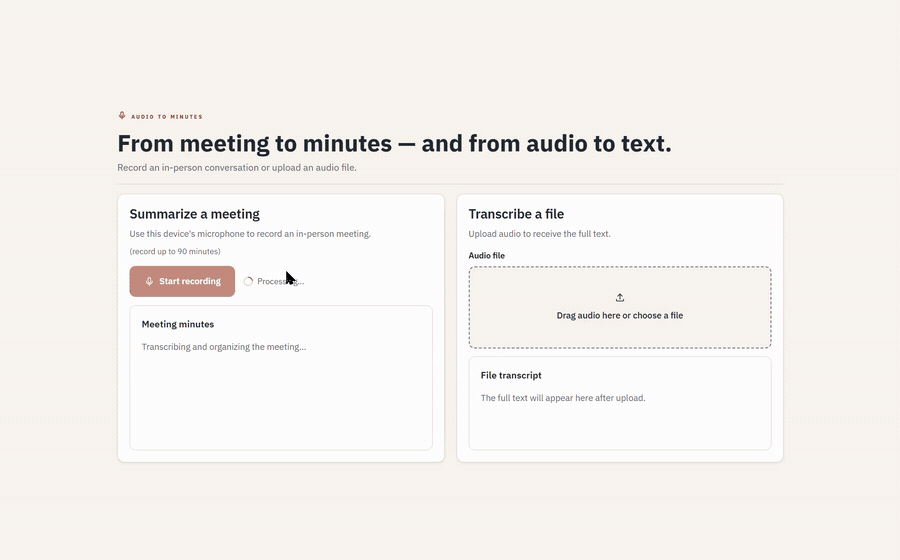

<!-- readme-type: demo -->
# 🎙️ Demo 1 — Audio to Minutes

> Record a meeting to get a structured recap and action list, or upload an audio file to get a full transcription — all from one web interface backed by an n8n workflow.

> ⚠️ Demo data only: bring your own accounts and never upload audio you are not allowed to process.


A meeting spoken into the browser, coming back as minutes:



The full two-minute walkthrough, with sound, is in [`assets/demo-1-audio-to-minutes.mp4`](assets/demo-1-audio-to-minutes.mp4) — download it to watch; GitHub does not play video of that size in the browser.

## 🧩 What it does

Two modes, one interface:

- **Record a meeting** (`mode: reuniao`) → returns an executive **summary**, the **decisions** and an atomic **action list**. The formatted minutes can be downloaded as a Markdown file (`meeting-minutes.md`).
- **Upload an audio file** (`mode: arquivo`) → returns the **full transcription** verbatim, without inventing a meeting summary. The transcription can be downloaded in full.

Accepted audio: WEBM, MP3, WAV, M4A, OGG — up to 25 MB.

## 🗺️ Architecture

| Layer | Technology | Role |
|-------|-----------|------|
| Front | React + TanStack Start (Vite) | Interface the user operates |
| Orchestration | n8n (webhook) | Routes the request by mode |
| Speech-to-text | Groq Whisper | Audio → text |
| Structuring | OpenAI | Summary, decisions and actions (meeting mode) |
| Persistence | Postgres (Neon) | Stores the transcription and summary for later retrieval |

```text
UI → n8n webhook → Groq Whisper → route by mode
                              ├─ reuniao → OpenAI → validation → Postgres → response
                              └─ arquivo ─────────────────────────────────→ response
```

A second webhook returns a stored transcription by id.

## ⚙️ How to run

**Prerequisites** — an n8n instance; credentials for Groq, OpenAI and a Postgres database (Neon works); [Node.js 20+](https://nodejs.org).

**Setup**

1. Create the transcriptions table: run [`db/transcricoes.sql`](db/transcricoes.sql) on your database.
2. Import [`workflows/audio-summary.json`](workflows/audio-summary.json) into n8n, attach your own credentials and activate it. The export is sanitized — no credentials, credential ids or personal hosts.
3. Configure the app with your two webhook URLs:

```powershell
Copy-Item .\ui\.env.example .\ui\.env.local
```

`.env.local` is git-ignored; the repository ships placeholders only.

**Run**

```powershell
npm install
npm run dev
```

Vite prints the local address.

## 🔌 Webhook contract

**Request — UI → n8n** (`VITE_DEMO1_TRANSCRIBE_URL`) · `POST` · `multipart/form-data`

```text
file: <audio blob>          # WEBM | MP3 | WAV | M4A | OGG, ≤ 25 MB
mode: "reuniao" | "arquivo"
```

**Response — n8n → UI** · `application/json`

```jsonc
// mode: reuniao
{ "resumo": "…", "decisoes": ["…"], "acoes": ["…"] }

// mode: arquivo
{ "transcricao": "…" }
```

**Retrieve a transcription** (`VITE_DEMO1_DOWNLOAD_URL`) — `GET …?id=<meetingId>` → `{ "transcricao": "…" }`

**Errors:** the UI shows an explicit state for timeout, network failure, invalid format and an unconfigured integration — never a blank screen.

## 📦 Files

- `ui/` — React / TanStack Start source
- `workflows/audio-summary.json` — n8n export, no credentials
- `db/transcricoes.sql` — the `transcricoes` table
- `assets/` — interface screenshot, workflow diagram and the walkthrough recording
