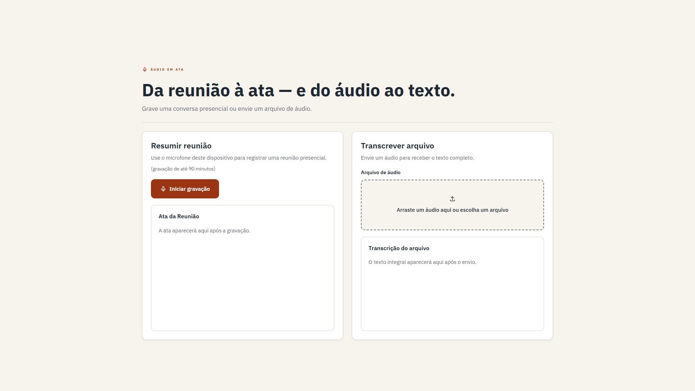

# Demo 1 — Audio meeting summary and file transcription

This demo turns recorded meetings into an executive recap and converts uploaded audio into a full
transcription. The web interface calls an n8n workflow that orchestrates transcription, AI
structuring, persistence and document download.



## What it delivers

- **Record a meeting:** summary, decisions, atomic actions and a new recommendation.
- **Upload an audio file:** full transcription without inventing a meeting summary.
- **Use the result:** copy, download or print the generated documents.

## Architecture

```text
React UI → n8n webhook → Groq Whisper → route by mode
                                  ├─ meeting → OpenAI → validation → Neon → response
                                  └─ file ───────────────────────────────→ response
```

The UI is independent from Lovable. Webhook URLs live only in `ui/.env.local`; the repository
contains placeholders in `ui/.env.example`.

## Run locally

```powershell
Set-Location .\demo-1-audio-summary\ui
Copy-Item .env.example .env.local
PowerShell -ExecutionPolicy Bypass -File .\scripts\setup.ps1
PowerShell -ExecutionPolicy Bypass -File .\scripts\dev.ps1
```

Open `http://127.0.0.1:8080/`.

## QA status

- Frontend lint and production build: passed.
- File transcription and physical microphone transport to n8n: passed.
- Semantic v4 fixture: still under refinement; the demo is not marked final until the quality gate passes.

## Files

- `ui/` — React/TanStack source.
- `assets/` — final screenshot and workflow diagram.
- `tests/` — reusable offline and live QA utilities; private audio/results remain ignored.
- `workflow.json` — sanitized n8n export, added only after the final semantic gate.
