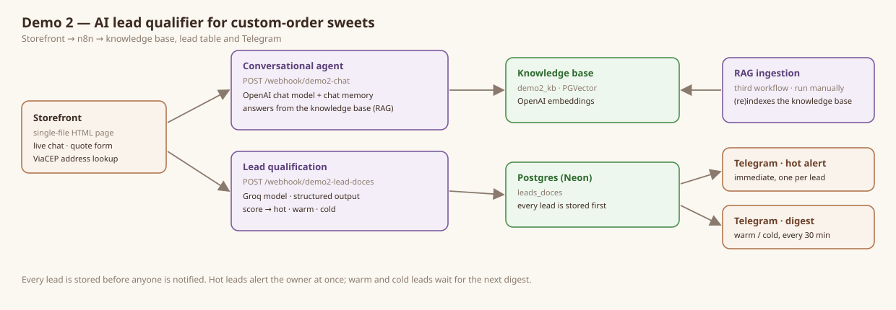

# Demo 2 — AI Lead Qualifier for Custom-Order Sweets

> A Portuguese-language conversational storefront for the fictional **Doce Aurora** confectionery: it answers questions from a controlled knowledge base, captures a quote request, scores the lead and alerts the owner instantly when the lead is hot.



## What it does

1. A visitor **chats** with the assistant or opens the **quote form**.
2. The conversational agent uses **RAG** to answer from the Doce Aurora knowledge base (`demo2_kb`).
3. A structured quote request is **scored** and classified as `hot`, `warm` or `cold`.
4. **Every lead is stored first.** Hot leads trigger an immediate **Telegram** alert to the owner; warm and cold leads are grouped into a digest sent every 30 minutes.

The form fills the address from the Brazilian postal code (ViaCEP) and accepts an optional reference image.

## How it works

| Layer | Technology | Role |
|-------|-----------|------|
| Front | Single-file HTML/CSS/JS (`ui/index.html`) | Storefront, live chat and quote form |
| Orchestration | n8n (3 workflows) | Conversation, qualification and routing, knowledge-base ingestion |
| Conversation | OpenAI chat model + PGVector | Grounded answers over `demo2_kb`, with chat memory |
| Qualification | Groq model, structured output | Score and tier for each lead |
| Persistence | Postgres (Neon) — `leads_doces` | Records every lead before notifying |
| Notification | Telegram | Instant alert on hot leads; 30-minute digest for the rest |

```text
HTML UI ─┬─ /webhook/demo2-chat        → conversational agent + RAG → grounded reply
         └─ /webhook/demo2-lead-doces  → qualification → Postgres → Telegram / response
```

A third workflow, **RAG ingestion**, is run manually to index the knowledge base into `demo2_kb`.

## Getting started

**Prerequisites** — an n8n instance; credentials for OpenAI, Groq, Telegram and a Postgres database with the `pgvector` extension (Neon works); Python 3 to serve the static page.

**Setup**

1. Create the leads table: run [`db/schema.sql`](db/schema.sql) on your database.
2. Import the three files in [`workflows/`](workflows/) into n8n, attach your credentials and put your chat id in the Telegram nodes. Run `rag-ingestion.json` once to index the knowledge base, then activate the other two. The exports carry no credentials.
3. Point the page at your webhooks:

```bash
cd demo-2-lead-qualify-doces/ui
cp config.example.js config.local.js   # set WEBHOOK_URL and CHAT_URL
```

`config.local.js` is git-ignored; the repository ships placeholders only.

**Run**

```bash
cd ..
python -m http.server 5599 --bind 127.0.0.1
```

Open `http://127.0.0.1:5599/ui/`.

## Webhook contract

**Quote / lead** (`WEBHOOK_URL` → `/webhook/demo2-lead-doces`) · `POST` · `application/json`

```jsonc
// request: form fields (name, contact, event, address via ViaCEP) + optional base64 image
// response:
{ "status": "ok", "id": 123, "tier": "hot|warm|cold", "score": 0, "message": "…" }
```

**Chat** (`CHAT_URL` → `/webhook/demo2-chat`) · `POST` · `application/json`

```jsonc
// request:
{ "sessionId": "<stable per visitor>", "message": "…" }
// response: the assistant's reply, rendered in streamed blocks
```

**Errors:** if a webhook is not configured, the page shows an explicit "configure the webhook to test this demo" state — never a blank screen.

## Scope and limitations

- The storefront and the knowledge base are in Brazilian Portuguese because the fictional customer is a Brazilian confectionery; this README and the workflow labels are in English.
- All business data is fictional. The image field is a demonstration input: production upload validation and storage isolation are out of scope.

## Project structure

- `ui/` — single-file storefront, quote form and live chat
- `workflows/` — n8n exports: `chat-rag.json`, `lead-qualification.json`, `rag-ingestion.json` (no credentials)
- `db/schema.sql` — the `leads_doces` table
- `assets/` — the architecture diagram and the reference photos used by the storefront (credits in `fotos-ref/CREDITOS.md`)
