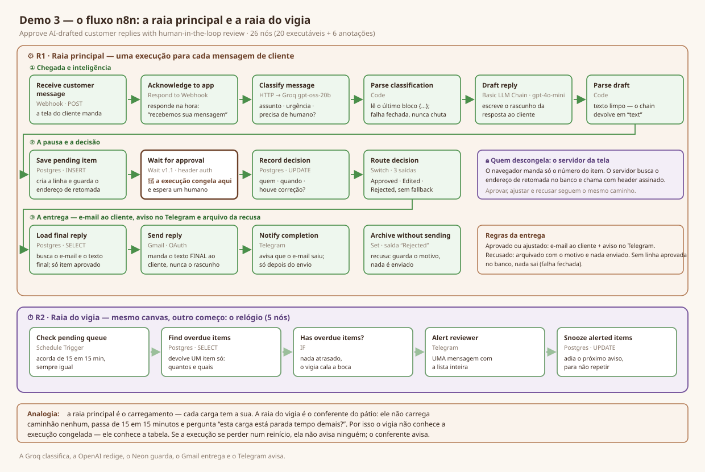

# ✋ Demo 3 — Human Approval in the Loop

> A customer writes in, an AI drafts the reply, and the workflow **freezes** until a human approves it. Nothing reaches the customer without a person clicking — and the workflow, not a cron job, is what waits.



## 🧩 What it does

One n8n workflow, two lanes on the same canvas:

- **Main lane** — a customer message arrives → the model **classifies** it (topic, urgency, does it need a human?) → a second model **drafts** the reply → the draft is stored in Postgres together with a private resume address → the execution **stops at a `Wait` node**. It stays frozen, with no polling and no cron, until a decision arrives. Then it records **who decided, when, and whether the text was corrected** — and routes to *approved · edited · rejected*.
- **Watchdog lane** — wakes on a clock (every 15 minutes), asks the database "is anything sitting unapproved for too long?", and pings the reviewer **once**, then snoozes those items for an hour so the same alert is not repeated on every tick. It never touches the main lane; it only reads the table. That is deliberate: a frozen execution that gets lost in a restart cannot alert anyone, so the thing that alerts must be alive.

The reviewer can send the draft as-is, edit it before sending, or refuse it with a reason. The `houve_correcao` (was it corrected?) column is the point of the demo: over time it becomes a trust scoreboard for the AI, per topic.

> **Status — read this before judging the demo.** The workflow's brain is built and proven; the reviewer screens and the outbound nodes are not. Every claim below is marked. See ✅ Proof.

## 🗺️ Architecture

| Layer | Technology | Role |
|-------|-----------|------|
| Front | React 19 + TanStack Start (Vite / Bun) | Customer screen, reviewer desk, follow-up screen |
| Server routes | TanStack Start (same app) | Reads the queue; holds the resume address; signs the resume call |
| Orchestration | n8n (webhook + `Wait` node) | Classifies, drafts, **freezes**, resumes, records, delivers |
| Classification | Groq — `openai/gpt-oss-20b` | Topic · urgency · needs-a-human |
| Drafting | OpenAI — `gpt-4o-mini` (Basic LLM Chain) | Writes the reply |
| Persistence | Neon (Postgres) — `aprovacoes_pendentes`, 19 columns | The pending queue and the decision log |

```text
Customer screen → n8n webhook → classify (Groq) → parse → draft (OpenAI) → parse
                                                                             ↓
                            INSERT row + resume address → ⏸ Wait (frozen) ────┘
                                                            ↑
                    reviewer clicks → server route → signed resume call
                                                            ↓
                              record decision → route → send · archive · notify
```

Two diagrams live in `assets/diagrams/`: [`01-fluxo.svg`](assets/diagrams/01-fluxo.svg) (the flow, node by node, with what is proven and what is planned) and [`00-esqueleto.svg`](assets/diagrams/00-esqueleto.svg) (the anatomy: folders, lanes, screens).

**Why the resume address never reaches the browser:** whoever holds it can approve as if they were you. It is stored in the database, read only by the server, and the browser sends nothing but the item's id — `{ "id": 42, "decisao": "aprovar" }`.

## ⚙️ How to run

```powershell
Set-Location .\demo-3-aprovacao-humana\ui
Copy-Item .env.example .env.local   # fill in DATABASE_URL and VITE_DEMO3_WEBHOOK_URL
bun install
bun run dev
```

Open `http://127.0.0.1:8080/`. You bring your own accounts — n8n, Groq, OpenAI and a Postgres database (Neon works out of the box). Nothing is hosted by us, and no credential is committed: `ui/.env.example` ships placeholders only, and `.env.local` is git-ignored.

The database table is in [`db/aprovacoes-pendentes.sql`](db/aprovacoes-pendentes.sql) — run it once against your database before the first message.

## 🔌 Webhook contract

**Request — customer screen → n8n** (`VITE_DEMO3_WEBHOOK_URL`)
`POST` · `application/json`
```jsonc
{
  "origem": "web",
  "remetente": { "nome": "Ana Ribeiro", "email": "ana@exemplo.com" },
  "mensagem": "Comprei o produto errado, posso trocar?",
  "recebido_em": "2026-09-28T14:03:11.000Z"
}
```

**Response — n8n → screen** (`application/json`) — answered immediately, before any model runs:
```jsonc
{ "itemId": null, "status": "pendente" }
```
`itemId` is `null` on purpose: the acknowledgement is sent *before* the row exists, so the customer screen never waits on two model calls. The real id is born with the `INSERT`. The customer finds their message again on `/acompanhar`, by the e-mail they used.

**Queue — server route → reviewer screen** · `GET /api/pendentes` → 8 fields, most urgent first:
```jsonc
{ "id": "42", "cliente_nome": "…", "assunto": "exchange", "urgencia": 3,
  "resumo": "…", "mensagem_cliente": "…", "rascunho": "…", "esperando_ha_min": 7 }
```
`urgencia` is `1 | 2 | 3`, where **3 is the most urgent**. `resume_url` is **deliberately absent** — it is a server-side secret, not a field.

**Decision — reviewer screen → server route** · `POST /api/decisao` with `{ id, decisao: "aprovar" | "ajustar" | "recusar", texto_final?, motivo? }`. The server looks the resume address up **by id**, calls it with a signed header, and refuses any item that is no longer `pendente`. *Built and covered by offline tests; not yet proven by a real click.*

**Follow-up — customer screen → server route** · `POST /api/meu-pedido` with `{ email }` → the customer's own messages and, **only once a person has approved it**, the reply text. The unapproved draft is never returned.

**Errors:** the interface always speaks plain customer-service language — never a raw status code, never a blank screen.

## ✅ Proof

**Proven, with evidence:**
- `26/26` offline parser tests green over **real captured payloads**, not assumed shapes — including the empty-response and rate-limited cases.
- `17/17` offline tests green on the server-route contracts: the queue mapping, the decision rules, and the guarantee that the customer follow-up **never returns an unapproved draft** (`bun run test` inside `ui/`).
- An execution **froze at the `Wait` node and resumed**, with the decision written to the database: row closed as `ajustado`, `houve_correcao = true`, `decidido_por` filled in.
- A message written in the **customer screen** travelled through the webhook and became a real row in `aprovacoes_pendentes`.
- `GET /api/pendentes` returns the 8-field contract and **no extra field** — checked in the browser's network tab; `resume_url` never appears.
- The **watchdog fired on its own clock** and, with two items past the deadline, sent **one** aggregated alert instead of one message per row — then snoozed both so the same alert is not repeated on the next tick.
- No secrets, no personal hosts and no credential ids in this repository.

- **The full loop, by clicking**: a reviewer pressed *approve* in the interface, a run that had been **frozen for 10h28m** woke up, the decision was written with who decided and whether the text was corrected, and the customer then read the approved reply on the follow-up screen. No polling, no cron — the run simply waited.

**Not proven yet — and marked as such everywhere:**
- Sending the approved reply to the real customer (`Send reply`) — that node is not wired yet.
- The completion notice on Telegram (the watchdog alert *is* proven; this is the other one).
- The *rejected* path: *approved* and *edited* are both proven, *rejected* is not.

## 📦 Files

- `ui/` — React / TanStack Start source, including the server routes and their offline tests.
- `db/aprovacoes-pendentes.sql` — the pending-queue table (19 columns). Run it once before the first message.
- `assets/diagrams/` — the flow diagram and the anatomy diagram.
- `workflows/` — sanitized n8n export *(not exported yet)*.

The parser tests and the working notes stay on the author's disk: this repository is the demo, not the build log.

## 🏷️ Tags

`#n8n` `#human-in-the-loop` `#approval-workflow` `#wait-node` `#groq` `#openai` `#postgres` `#react` `#automation`
